# Katori

**Eat well, know why.**

Katori is a personal health assistant for busy people in India who want to lose weight or fix a
lab value (sugar, cholesterol, vitamin D). You snap or speak a meal once; Katori logs it, does
the maths, explains why it matters for _your_ goal and lab results, and reaches out first.

<p>
  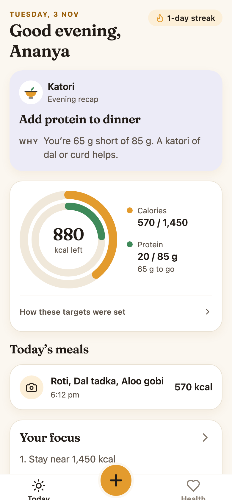
  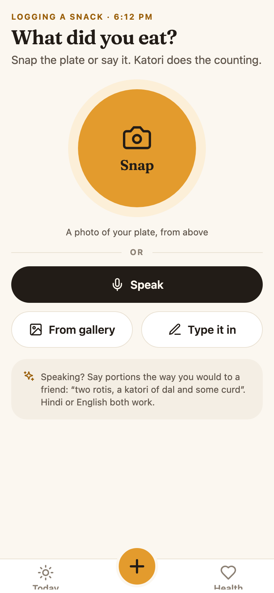
  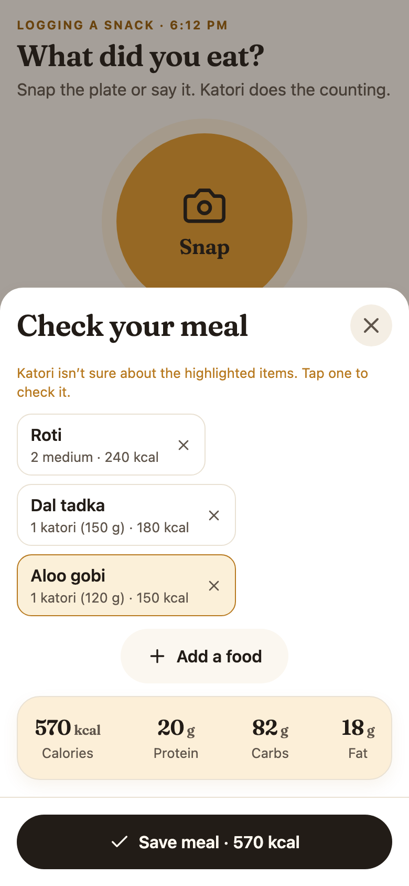
  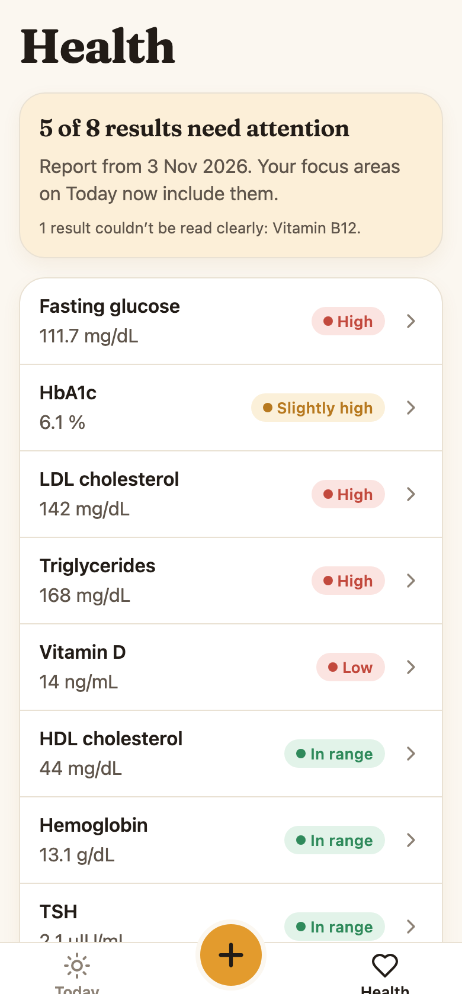
</p>

## The problem and the user

**User:** a 22 to 35 year old in India, busy, who wants to lose weight or bring down a number on
a blood report. They have tried calorie apps and quit.

**Why they quit:** logging is tedious (search, scroll, guess grams for "dal") and the numbers mean
nothing ("1,640 kcal... so what?"). Generic apps also don't know a katori from a cup.

**Katori's answer, the personal assistant test:** like a celebrity's assistant, the app does the
heavy lifting. The user only snaps, speaks or taps once. Katori logs, calculates, explains with a
clear _why_, and nudges at the right moment.

## The four flows

|     | Flow                                    | What it does                                                                                                                                                                                                                                                                                                                                          |
| --- | --------------------------------------- | ----------------------------------------------------------------------------------------------------------------------------------------------------------------------------------------------------------------------------------------------------------------------------------------------------------------------------------------------------- |
| 1   | **Onboarding with a goal and a why**    | Five short cards (name, age and sex, height and weight with cm or ft/in, activity, goal) plus an optional blood report. Ends on **Your Plan**: calorie and protein targets, _how they were worked out_, and 2 or 3 focus areas, each with a one line why.                                                                                             |
| 2   | **Log a meal by photo or voice** (hero) | The raised **+** in the middle of the tab bar opens one screen: a big **Snap** button, **Speak** under it, gallery and typing as fallbacks. After saving, Today opens so the rings visibly move. The AI returns food chips with portions in Indian units; the user removes, resizes (½× to 3×) or confirms doubtful items, then saves. Works offline. |
| 3   | **Today: the assistant comes to you**   | Rings showing what is left, an assistant card that changes through the day (always with a why), meal timeline, streak flame, weekly wins, confetti when the daily goal is hit, reminders at learned meal times.                                                                                                                                       |
| 4   | **Health report reader**                | Upload a photo or PDF of a blood report. Markers are listed green, amber or red; each opens a sheet with where it sits in the healthy range, why it matters and one food action. Today's focus areas update automatically.                                                                                                                            |

<p>
  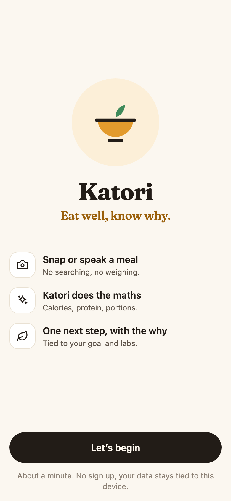
  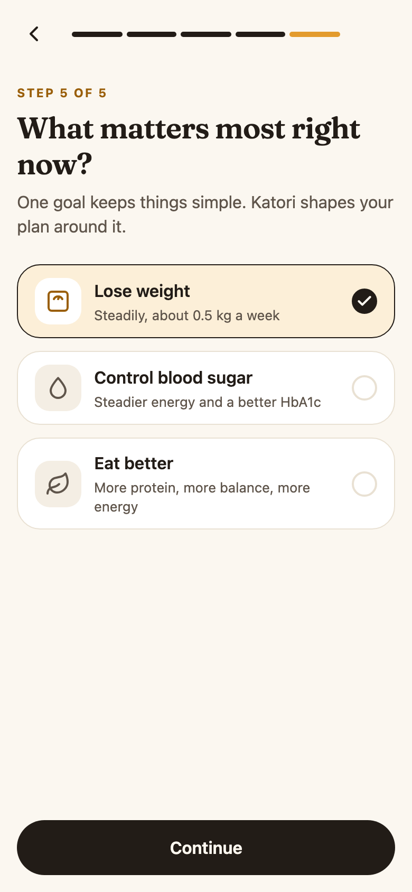
  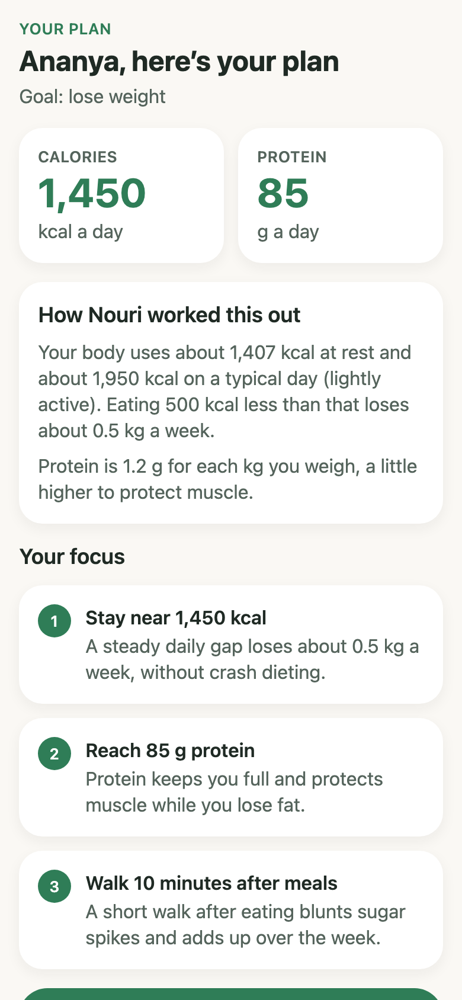
  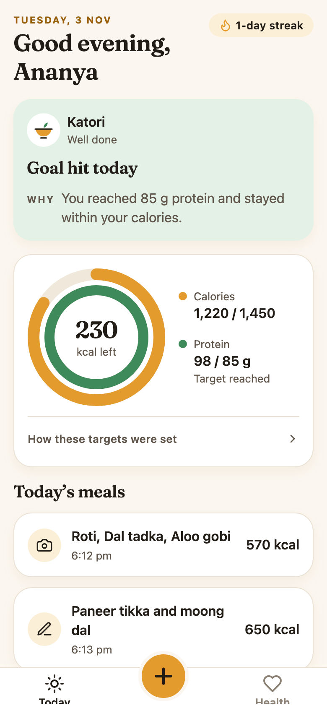
  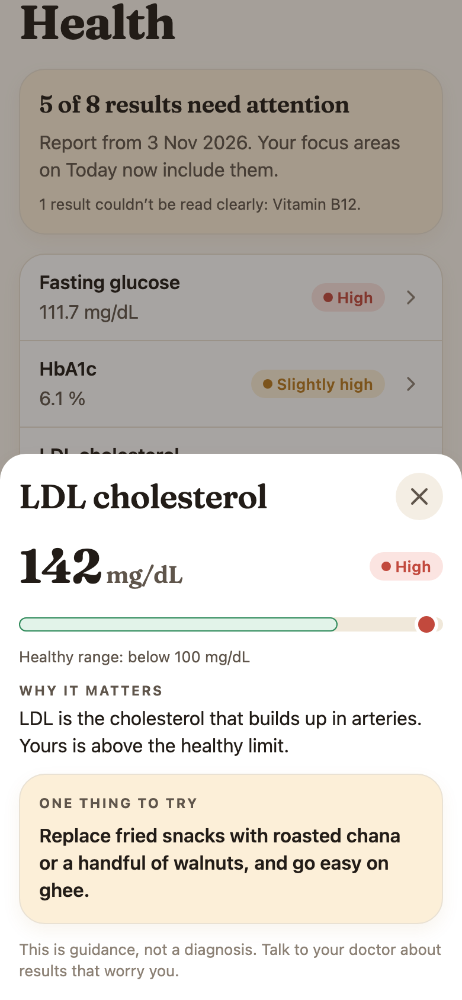
</p>

On tablets and desktop web the same sheets become centred dialogs:

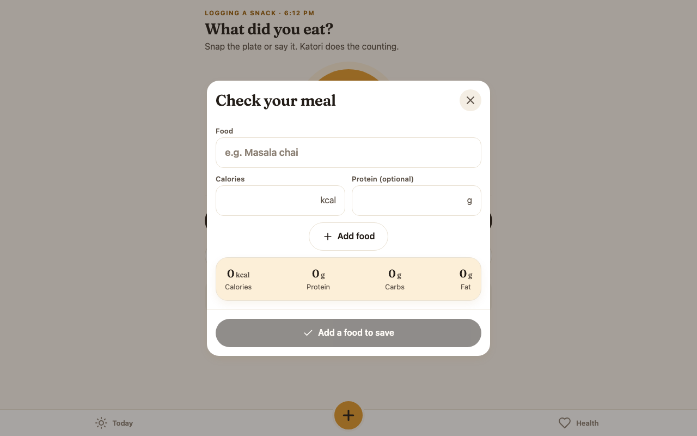

## What was cut, and why

- **Login.** One local profile identified by a device id generated on first launch. Accounts add
  friction before any value and are not core to the problem.
- **Fitness tracker integrations.** Large scope (several SDKs, permissions, sync) for little gain
  towards eating better.
- **Chat as the main screen.** Chat is hard to get right and puts the work on the user. Katori
  speaks through cards, sheets and nudges instead.
- **A separate profile screen.** Goals and progress live on Today; the plan is one tap away.

## Product decisions

- **AI does perception, code does judgement.** The model reads photos, voice and reports. Targets,
  totals, streaks, lab status, focus areas and the assistant's message are deterministic code:
  the same input always gives the same answer, and every number can be explained.
- **Health advice is written, not generated.** Each out of range marker gets reviewed text with an
  Indian food action ("roasted chana instead of fried snacks"). The model never improvises advice.
- **Show the why.** The plan explains its own maths ("1,379 kcal at rest, about 1,900 on a lightly
  active day, minus 500 to lose about 0.5 kg a week"). The assistant card always carries a reason.
- **Indian context first.** Katori (bowl) portions, roti counts, Hindi and English voice notes, ft/in height,
  IST day boundaries, dal and paneer in every suggestion.
- **Remaining, not consumed.** Rings show what is left today, which is what a person decides on.
- **One clear action per screen, and every failure has a way forward:** retry, retake, record
  again, or add by hand.
- **Kind, not judgemental.** Day one gets a welcome, an over day gets "that's okay, tomorrow starts
  fresh", and wins get confetti once, not every time.
- **Honest copy.** The report step says the file is read by AI and then discarded; lab sheets say
  "guidance, not a diagnosis".

### Design direction

Most health apps are white, mint green and a sans serif, and they all blur together. Katori is
named after the small bowl Indian portions are measured in, and the look comes from the same
kitchen:

- **Palette:** warm paper background, ink for text and main buttons, turmeric as the brand colour
  (calorie ring, highlights) and curry leaf green for protein. Lab statuses keep the familiar green,
  amber and red, because those must read instantly. Light only, every pair checked for AA contrast.
- **Type:** Fraunces, a warm serif, for headlines and the big numbers, so the app reads like a
  friendly food column instead of a spreadsheet. Body text stays on the system font (two font
  weights, about 70 KB each, are the only additions).
- **Today's katori:** calories and protein are nested rings, like a bowl seen from above, with
  what is left in the middle.
- **An assistant with a face:** the bowl mark speaks on the assistant card, whose colour follows
  the day (turmeric morning, leaf afternoon, dusk evening) so a new check in is visible at a glance.
- **Logging is the centre tab:** a raised turmeric **+** in the middle of the tab bar, under the
  thumb on every main screen. It opens one screen with a big Snap circle (a photo gives the best
  estimate for the least effort), Speak right under it, and "From gallery" and "Type it in" as
  fallbacks. Meal reminders open this screen directly. Today stays a read of your day; on day
  one its empty meal list has a "Log your first meal" button.
- **Onboarding that feels like a conversation:** a welcome screen with three promises, then one
  serif question per step with a segmented progress bar, icons for goals and signal bars for
  activity level. The plan arrives as an ink card with the two numbers, the maths, then numbered
  focus areas.

## Architecture

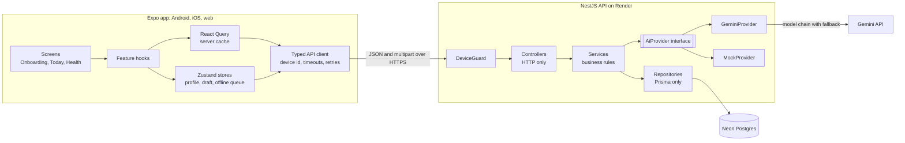

**Mobile (`mobile/`)**: Expo SDK 58, TypeScript strict, Expo Router. Routes are one line
re-exports; each feature (`onboarding`, `meals`, `today`, `reports`) owns its components, hooks
and logic. Pure health logic lives in `src/lib/health` with unit tests. Server state is in React
Query; local state (profile, onboarding draft, offline queue) in persisted Zustand stores. All
colours, spacing and type come from `src/theme`. UI kit: `Button`, `Card`, `Chip`, `ProgressRing`
(SVG plus Reanimated, no chart library), `AdaptiveSheet` (bottom sheet on phones, centred dialog
on wide screens), `EmptyState`, `ErrorState`, `Skeleton`, `Toast`, `Confetti`.

**Server (`server/`)**: NestJS 12, Prisma 7 on Neon Postgres, Zod for all validation.
Controller, service and repository layers; services throw coded `AppError`s and never touch HTTP
or Prisma; a global filter maps codes to statuses and returns one error shape:
`{ error: { code, message, details? } }`. Identity is a global `DeviceGuard` on `x-device-id`,
so new routes are protected by default.

**Scalability choices**: stateless API (any number of instances); Neon pooled connection for the
app and direct connection for migrations; files processed in memory, never stored; per user
idempotency keys; an indexed `(userId, eatenAt)` for day queries; AI provider swappable by config.

## AI choices and fallbacks

- **Provider:** Google Gemini (Flash family) through `@google/genai`: one model reads images,
  audio and PDFs and returns JSON matching a schema. Behind an `AiProvider` interface, so another
  provider is one new class and one env change. `MockProvider` serves tests and offline demos.
- **Contracts:** every answer is validated with Zod. A malformed answer gets one retry, then a
  clear error. Gemini is sent a shape only schema (some models reject `minLength`); Zod still
  enforces every limit.
- **Resilience:** timeout on every call; a model chain (`GEMINI_MODELS`) that moves on when a
  model is overloaded (503), out of quota (429), retired (404) or slow; a 400 is not retried.
- **Voice is two calls on purpose.** Asked to listen and estimate at once, the model invented a
  meal from pure silence. Now it first transcribes ("is there speech, what was said"), and food is
  estimated only from words that were heard. The app also shows "Heard: …" so mishearings are
  caught before saving, and phones check for silence before uploading.
- **Reports:** the model only copies what is printed. Code matches names (aliases like
  "Glucose - Fasting", "FBS"), converts units (mmol/L, mmol/mol, nmol/L, g/L), decides status
  (lab range first, sex aware defaults otherwise) and attaches reviewed guidance.
- **Assistant card:** a rules engine on the phone picks the message; the server asks the model
  to phrase it warmly and returns the rules draft if anything fails. The card shows the rules
  text instantly and swaps in the phrasing when it arrives, so it is never empty.

## Edge cases handled

| Area       | Cases                                                                                                                                                                                                                             |
| ---------- | --------------------------------------------------------------------------------------------------------------------------------------------------------------------------------------------------------------------------------- |
| Meal photo | Not food, blurry, low confidence items highlighted for confirmation, AI timeout or busy (retry with the same photo), camera permission denied (Settings, choose a photo, or add by hand)                                          |
| Voice      | Silence (checked on the phone and by the listen first step), too short, unclear speech, microphone denied, 30 s limit with auto stop, double stop guarded                                                                         |
| Saving     | Offline: kept on the phone, counted in today, "Waiting to sync", synced on reconnect or app foreground; double tap: button disabled plus an idempotency key created with the draft; server rejection shown, never retried forever |
| Reports    | Not a report, unreadable, partial extraction (lists what was skipped), unknown markers (judged by the lab's printed range), unit differences, repeated markers, cancelled picker                                                  |
| Onboarding | Validation with friendly messages after the first Continue, back keeps answers, restart resumes at the last step, missing answer at the end sends the person back, offline finish syncs later                                     |
| App        | Saved data loads behind the splash (no flicker), error boundary, offline banners, 320 px screens, reduced motion, Android back closes sheets, screen reader labels                                                                |
| Server     | Env validated at boot, database asleep or down (health 503, no crash), framework errors replaced with plain messages, upload type and size limits                                                                                 |

## Getting started

Requirements: Node 22+, npm, and for the app either Expo Go on a phone or a browser.

```bash
# API
cd server
cp .env.example .env        # fill in DATABASE_URL, DIRECT_URL and GEMINI_API_KEY
npm install
npx prisma migrate deploy
npm run start:dev           # http://localhost:3000/health

# App
cd mobile
npm install
npx expo start              # press w for web, or scan the QR code with Expo Go
```

In development the app finds the API automatically on port 3000 of the computer running Expo
(same Wi-Fi for a phone). Set `EXPO_PUBLIC_API_URL` in `mobile/.env` to override it.
`AI_PROVIDER=mock` in `server/.env` runs everything without Gemini.

### Environment

| Variable              | Where  | Purpose                                         |
| --------------------- | ------ | ----------------------------------------------- |
| `DATABASE_URL`        | server | Neon pooled connection, used by the app         |
| `DIRECT_URL`          | server | Neon direct connection, used by migrations      |
| `GEMINI_API_KEY`      | server | Gemini key (not needed with `AI_PROVIDER=mock`) |
| `GEMINI_MODELS`       | server | Model chain, tried in order                     |
| `AI_TIMEOUT_MS`       | server | Per call AI timeout (default 20000)             |
| `EXPO_PUBLIC_API_URL` | mobile | API base URL; required for release builds       |

## Testing

| Layer       | What                                                                                                                                  | Command                                             |
| ----------- | ------------------------------------------------------------------------------------------------------------------------------------- | --------------------------------------------------- |
| Server unit | Targets, streak, biomarker normalisation, Gemini retry and fallback, insights fallback, guard, error filter, env                      | `cd server && npm test`                             |
| Server e2e  | Real HTTP stack with in memory repositories and the mock AI                                                                           | `cd server && npm run test:e2e`                     |
| Mobile unit | Targets (parity with the server), focus areas, assistant rules, weekly wins, validation, meal maths, offline first saving, API client | `cd mobile && npm test`                             |
| Browser e2e | Every flow against the real API and database, offline, double tap, 320 px                                                             | `./e2e/run.sh` (see [e2e/README.md](e2e/README.md)) |

## Deployment and builds

- **API:** `render.yaml` is a Render Blueprint (Singapore, next to the Neon database). Secrets
  are set in the Render dashboard. Migrations run during the build.
- **Android:** `eas build --profile preview --platform android` builds an installable APK.
  Release builds are minified and resource shrunk (`expo-build-properties`).

## Known limitations and what comes next

- **Gemini free tier:** about 20 requests per model per day. The model chain absorbs it in
  testing; real use needs billing enabled.
- **Portions are estimates.** Chips and the portion stepper make correction fast, but there is no
  barcode or recipe database yet.
- **One profile per device.** No sync across devices until accounts exist.
- **Next:** an overall deadline per AI request, rate limiting on AI endpoints, a shared types
  package between app and server, editing the profile from the plan, weekly emails or summaries,
  and push notifications from the server for insights.
